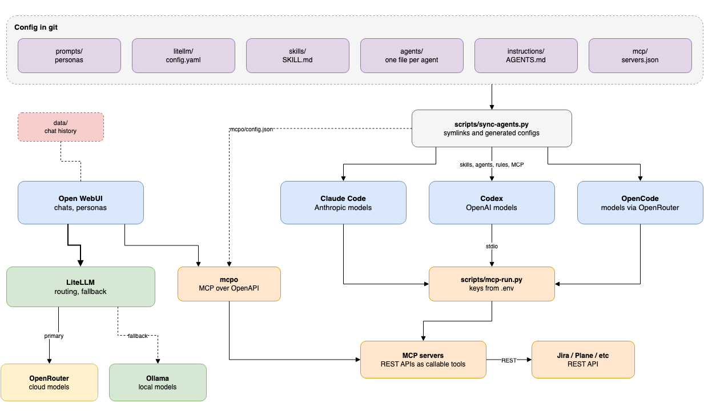

# ai-workspace

Local AI environment with swappable model providers.

## Overview

A LiteLLM gateway routes requests to cloud or local models under stable aliases. Switching providers means editing one YAML file. The gateway runs natively, no Docker: `scripts/gateway.sh`.

Claude Code, Codex and OpenCode share skills, agents, global instructions and MCP servers. The repository holds one source for each, `scripts/sync-agents.py` lays it out into every tool's config.

## Components

| Service | Port | Role | Runs |
|---|---|---|---|
| LiteLLM | 4000 | gateway, routing, fallback | native, `scripts/gateway.sh` |
| Ollama | 11434 | local inference, last link of every fallback chain | native, from the external SSD, `scripts/ollama.sh` |
| Open WebUI | 3000 | browser chats, personas | Docker, optional |
| mcpo | 8000 | MCP over OpenAPI for Open WebUI | Docker, optional |

Ollama runs outside Docker. Containers on macOS have no Metal access. `docker-compose.yml` still carries its own LiteLLM on the same port: stop `gateway.sh` before `docker compose up`.

## Setup

```bash
git clone <repo> && cd ai-workspace
./bootstrap.sh
```

The script creates `.env` and exits. Fill in the keys, then run again:

```bash
./bootstrap.sh full
```

Profiles: `full` (48 GB), `light` (16–32 GB), `cloud` (no local models).

The script also runs `scripts/sync-agents.py`, which links skills and agents into Claude Code, Codex and OpenCode and generates `mcpo/config.json`.

Then create an account in Open WebUI, get an API key from Settings → Account, add it to `.env`, and sync personas:

```bash
python3 scripts/sync-personas.py
```

## Gateway without Docker

```bash
scripts/gateway.sh start    # first run installs LiteLLM into build/litellm-venv
scripts/gateway.sh status
scripts/gateway.sh restart  # after editing litellm/config.yaml
scripts/gateway.sh logs
```

The first start installs `uv` from PyPI and through it Python 3.12 with `litellm[proxy]`: dependencies have no builds for the newest system Python yet. Keys come from `.env`. `start` and `stop` also start and stop Ollama. `scripts/oc.sh` starts both when they are down.

## Local models

Ollama (MIT) runs from the external SSD, nothing goes into `/Applications`, no autostart:

| What | Where |
|---|---|
| binary | `$AI_KIT/runtime/ollama/<version>/` |
| models | `$AI_SSD/AI Models/ollama-models/` |
| model recipe | `litellm/ollama/gpt-oss-20b.Modelfile`, GGUF already on the SSD |

```bash
scripts/ollama.sh list                     # any Ollama command, with the SSD paths set
scripts/ollama.sh ps                       # what is loaded and how much is on the GPU
scripts/ollama.sh stop gpt-oss-20b-ssd     # unload the model, the server keeps running
```

`gpt-oss-coder-local` (gpt-oss-20b, 16k context) is the last link of every chain: it answers with no internet and no account. On a 16 GB Mac it is the ceiling: 12 GB of weights, 91% on the GPU, ~17 tokens/s, about 1 GB of RAM left. Agents call tools on it, but follow instructions weaker than cloud models.

Without the SSD the gateway still starts, prints that local models are unavailable, and the chain ends with a connection error.

LM Studio is not used: it is closed source, and its defaults (`mlock`, four parallel slots) froze this Mac on the same model. Its installer stays in the offline kit.

## Layout

```
ai-workspace/
├── docker-compose.yml
├── bootstrap.sh
├── litellm/
│   ├── config.yaml          model aliases, fallback
│   └── ollama/              Modelfiles for local models
├── prompts/                 Open WebUI personas
├── prompts.local/           personas, not in git
├── openspec/                specs and planned changes, artifacts in Russian
├── instructions/AGENTS.md   global rules for all three tools
├── skills/                  skills
├── skills.local/            skills, not in git
├── agents/                  agents, neutral format
│   └── targets.json         model tier per tool
├── agents.local/            agents, not in git
├── mcp/servers.json         MCP servers
├── opencode/
│   ├── opencode.jsonc       personal overrides, not in git
│   └── opencode.example.jsonc
├── mcpo/config.json         generated, not in git
├── build/                   generated agents, not in git
├── scripts/
│   ├── sync-agents.py       skills, agents, rules, MCP -> tools
│   ├── mcp-run.py           starts an MCP server with keys from .env
│   ├── gateway.sh           LiteLLM without Docker, starts Ollama too
│   ├── ollama.sh            Ollama from the external SSD
│   ├── oc.sh                OpenCode with model keys from .env
│   ├── sync-personas.py
│   ├── backup.sh
│   └── restore.sh
└── data/                    Open WebUI database, not in git
```

## Model aliases

Personas and agents reference an alias, not a model:

```yaml
model_list:
  - model_name: nemotron-coder-cloud-free
    litellm_params:
      model: openrouter/nvidia/nemotron-3-ultra-550b-a55b:free
      api_key: os.environ/OPENROUTER_API_KEY
    model_info:
      max_input_tokens: 1000000
      max_output_tokens: 32768
```

Naming scheme: `model-role-location[-free]`. For example `nemotron-coder-cloud-free`, `glm-coder-cloud`, `qwen-coder-local`.

`sync-agents.py` builds OpenCode's `gateway` provider from `model_list`: every alias becomes `gateway/<alias>`, `model_info` gives the context limits. The default model and agent tiers come from `agents/targets.json`. Other providers and local Ollama models are in the file as commented templates.

Replacing the model behind an alias requires no changes to personas or agents:

```bash
# change model: in litellm/config.yaml
scripts/gateway.sh restart
```

Adding or removing an alias also needs `python3 scripts/sync-agents.py` and an OpenCode restart.

## Fallback

```yaml
router_settings:
  fallbacks:
    - nemotron-coder-cloud-free: ["north-coder-cloud-free", "gpt-oss-coder-local"]
    - glm-coder-cloud: ["deepseek-coder-cloud", "gpt-oss-coder-local"]
```

Triggers on any provider error: exhausted rate limit, insufficient credits, revoked key, no network, a model removed from OpenRouter. Free aliases fall back only to free ones and the local model, so a paid model never kicks in unasked. Every chain ends on the local model.

## Personas

A chat with a system prompt and a fixed model. File in `prompts/`:

```markdown
---
id: algo-coach
name: Coding Challenge Coach
base: nemotron-coder-cloud-free
temperature: 0.3
---
System prompt.
```

Required fields: `id`, `name`, `base`.

```bash
python3 scripts/sync-personas.py           # add and update
python3 scripts/sync-personas.py --prune   # remove those missing from files
python3 scripts/sync-personas.py --dry-run # print payload only
```

Git is the source of truth. Edits made in the interface get overwritten.

`sync-agents.py` hands the same personas to the coding tools. `base` stays with Open WebUI, the tools use the session model or `tier`:

| Tool | Persona becomes | How to pick it |
|---|---|---|
| Claude Code | output style `~/.claude/output-styles/<id>.md` | Settings → Claude Code → Output style, or `/config` in the CLI |
| Codex | profile `~/.codex/<id>.config.toml` | `codex -p <id>` |
| OpenCode | primary agent | Tab in the TUI, `--agent <id>` |

## Agents, skills, MCP

Shared by Claude Code, Codex and OpenCode. Edit the source in the repository, then:

```bash
python3 scripts/sync-agents.py            # apply
python3 scripts/sync-agents.py --dry-run  # show changes only
```

Tools read all of this at startup, so start a new session afterwards.

| Source | Claude Code | Codex | OpenCode |
|---|---|---|---|
| `skills/` | `~/.claude/skills/` | `~/.agents/skills/` | reads both |
| `agents/` | `~/.claude/agents/*.md` | `~/.codex/agents/*.toml` | `~/.config/opencode/agent/*.md` |
| `prompts/` | `~/.claude/output-styles/*.md` | `~/.codex/*.config.toml` | `~/.config/opencode/agent/*.md` |
| `instructions/AGENTS.md` | `~/.claude/CLAUDE.md` | `~/.codex/AGENTS.md` | `~/.config/opencode/AGENTS.md` |
| `mcp/servers.json` | `~/.claude.json` | `~/.codex/config.toml` | `~/.config/opencode/opencode.json` |
| `litellm/config.yaml` | — | — | `gateway` provider in `~/.config/opencode/opencode.json` |

Skills and instructions are symlinks into the repository. Agents are generated into `build/` and linked from there. The script recognizes its own links and entries and leaves everything else alone.

**Skill** — a procedure the model pulls in when the task matches its description. Same `SKILL.md` format in all three tools, see [skills/README.md](skills/README.md).

**Agent** — one file, three renderings:

```markdown
---
description: Code review. Changes nothing.
role: subagent        # primary | subagent
access: read-only     # read-only | edit
tier: smart           # key in agents/targets.json
---
Instructions.
```

`tier` maps to a model per tool in `agents/targets.json`. Primary agents go to OpenCode only. Details in [agents/README.md](agents/README.md).

**MCP server** — `mcp/servers.json`, Claude Desktop format. Secrets stay in `.env`:

```json
"jira": {
  "command": "uvx",
  "args": ["mcp-atlassian"],
  "env": { "JIRA_URL": "${JIRA_URL}", "JIRA_API_TOKEN": "${JIRA_API_TOKEN}" }
}
```

Client configs call `scripts/mcp-run.py <name>`, which reads `.env` and hands the server only the variables listed in its `env`. A server with an empty variable is skipped. Open WebUI gets the same servers through mcpo: `mcpo/config.json` is generated with values filled in, since the wrapper is not reachable from the container.

## OpenSpec

Requirements live in `openspec/specs/`, planned work in `openspec/changes/`. The project goal and hard rules for every change are in `openspec/config.yaml`.

| Tool | Propose | Apply |
|---|---|---|
| Claude Code | `/opsx:propose` | `/opsx:apply` |
| Codex | `$openspec-propose` | `$openspec-apply-change` |
| OpenCode | `/opsx-propose` | `/opsx-apply` |

Commands and skills are generated by `openspec init` into this project's `.claude/`, `.agents/` and `.opencode/`. Refresh them with `openspec update`.

```bash
openspec list                      # changes and task progress
openspec validate --all --strict
```

## Public and private

| Path | In git |
|---|---|
| `prompts/`, `skills/`, `agents/`, `mcp/` | yes |
| `prompts.local/`, `skills.local/`, `agents.local/` | no |
| `.env`, `data/`, `build/`, `mcpo/config.json` | no |

Config files reference environment variables, not values. The repository is publishable as is.

## Diagram


