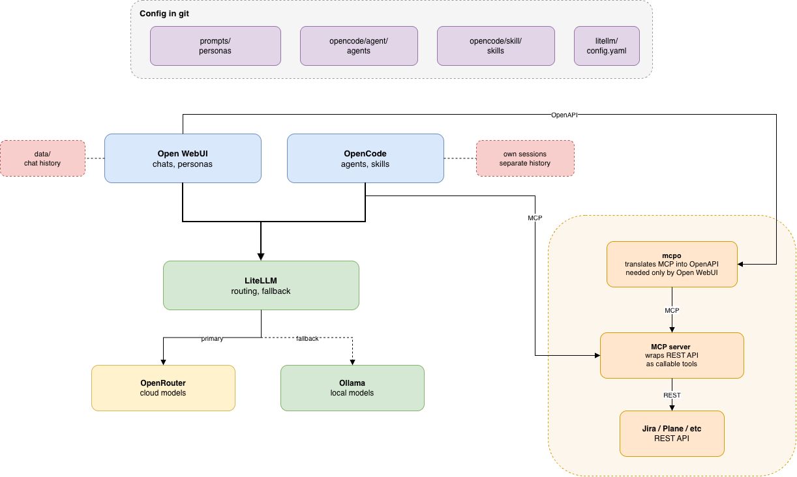

# ai-workspace

Local AI environment with swappable model providers.

## Overview

Open WebUI uses LiteLLM for chats. OpenCode selects models directly from its own config.

## Components

| Service | Port | Role |
|---|---|---|
| Open WebUI | 3000 | chats, personas |
| LiteLLM | 4000 | gateway, routing |
| mcpo | 8000 | MCP over OpenAPI |
| Ollama | 11434 | local inference, native |

Ollama runs outside Docker. Containers on macOS have no Metal access.

## Setup

```bash
git clone <repo> && cd ai-workspace
./bootstrap.sh
```

The script creates `.env` and exits. Fill in the keys, then run again:

```bash
./bootstrap.sh
```

Профиль `cloud` пропускает установку Ollama.

Then create an account in Open WebUI, get an API key from Settings → Account, add it to `.env`, and sync personas:

```bash
python3 scripts/sync-personas.py
```

## Layout

```
ai-workspace/
├── docker-compose.yml
├── bootstrap.sh
├── litellm/config.yaml      модель для Open WebUI
├── prompts/                 Open WebUI personas
├── prompts.local/           personas, not in git
├── agents/                  agents shared by Claude Code, OpenCode, Codex
├── opencode/
│   ├── opencode.jsonc       модели и токен для OpenCode, не в git
│   ├── opencode.example.jsonc шаблон без токена
│   ├── agent/               agents
│   ├── skill/               skills
│   └── skill.local/         skills, not in git
├── mcpo/config.json         MCP servers
├── scripts/
│   ├── sync-personas.py
│   ├── sync-agents.py
│   ├── backup.sh
│   └── restore.sh
└── data/                    Open WebUI database, not in git
```

## Модели OpenCode

Редактируй только `opencode/opencode.jsonc`. Этот файл уже подключён к OpenCode через
`~/.config/opencode/opencode.jsonc` и исключён из git. Если файла нет после нового
клонирования, скопируй `opencode/opencode.example.jsonc`.

В блоке `openrouter.options.apiKey` замени `ВСТАВЬ_ТОКЕН_OPENROUTER` своим токеном.
OpenCode уже знает каталог моделей OpenRouter — выбери нужную через `/models`.
Если какой-то модели в списке нет, добавь её точный ID в `openrouter.models`.
Таких строк может быть сколько угодно:

```json
"~anthropic/claude-sonnet-latest": {},
"~google/gemini-flash-latest": {}
```

Токен указывается один раз для всех моделей OpenRouter. Перезапусти OpenCode и
выбери модель через `/models`. OpenCode запомнит последнюю выбранную модель.
Локальная Ollama уже указана в том же файле.

## Personas

A chat with a system prompt and a fixed model. File in `prompts/`:

```markdown
---
id: algo-coach
name: Coding Challenge Coach
base: qwen3.8:27b-mlx
temperature: 0.3
---
System prompt.
```

Required fields: `id`, `name`, `base`.

```bash
python3 scripts/sync-personas.py           # add and update
python3 scripts/sync-personas.py --prune   # remove those missing from files
python3 scripts/sync-personas.py --dry-run # print payload only
```

Git is the source of truth. Edits made in the interface get overwritten.

## Shared agents

One file in `agents/` becomes an agent in Claude Code, OpenCode and Codex:

```markdown
---
name: functional-tester
description: When to call it
readonly: true
---
Instructions.
```

```bash
python3 scripts/sync-agents.py           # write
python3 scripts/sync-agents.py --dry-run # show what would change
```

| Tool | Generated file |
|---|---|
| Claude Code | `~/.claude/agents/<name>.md` |
| OpenCode | `opencode/agent/<name>.md` |
| Codex | `~/.codex/agents/<name>.toml` |

`readonly: true` — the agent cannot edit code but may write reports to `reviews/`. OpenCode enforces it by permissions, Claude Code drops the Edit tool, Codex relies on the prompt only.
Edit the file in `agents/`; generated files get overwritten. `agents.local/` is not in git.

## Agents and skills

OpenCode only.

**Agent** — system prompt and tool permissions. Agents inherit the model selected in OpenCode:

```markdown
---
description: Code review
mode: subagent
tools:
  write: false
  edit: false
---
Instructions.
```

Modes: `primary` (selectable for a session), `subagent` (invoked via `@name`), `all`.

**Skill** — a procedure the model pulls in when the task matches its description. A folder in `opencode/skill/` containing `SKILL.md`:

```markdown
---
name: run-tests
description: Use when tests need to be run or a failure needs investigating
---
Instructions.
```

The model always sees `description`. The body loads only when the skill triggers.

Changes apply after restarting OpenCode.

## Public and private

| Path | In git |
|---|---|
| `prompts/`, `opencode/skill/` | yes |
| `prompts.local/`, `opencode/skill.local/` | no |
| `.env`, `opencode/opencode.jsonc`, `data/` | no |

Токен OpenRouter хранится только в игнорируемом `opencode/opencode.jsonc`.

## Diagram


